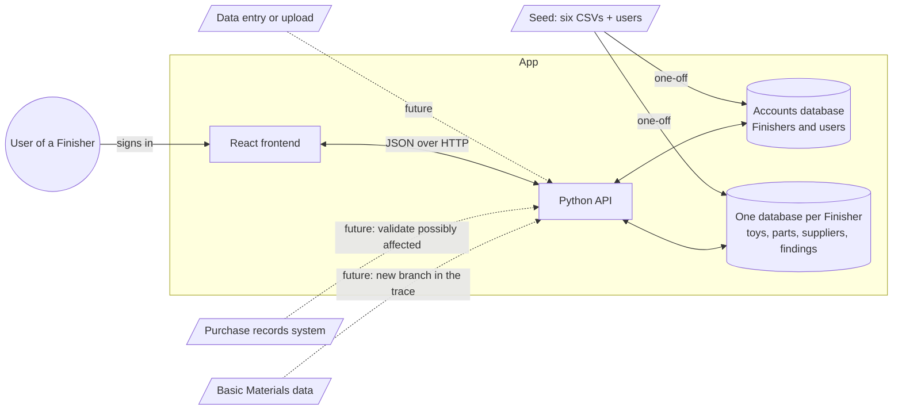
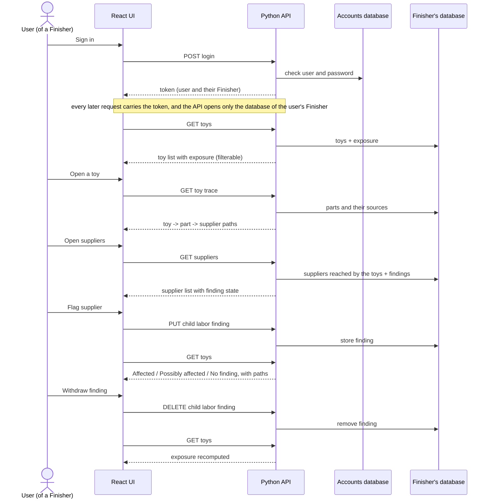
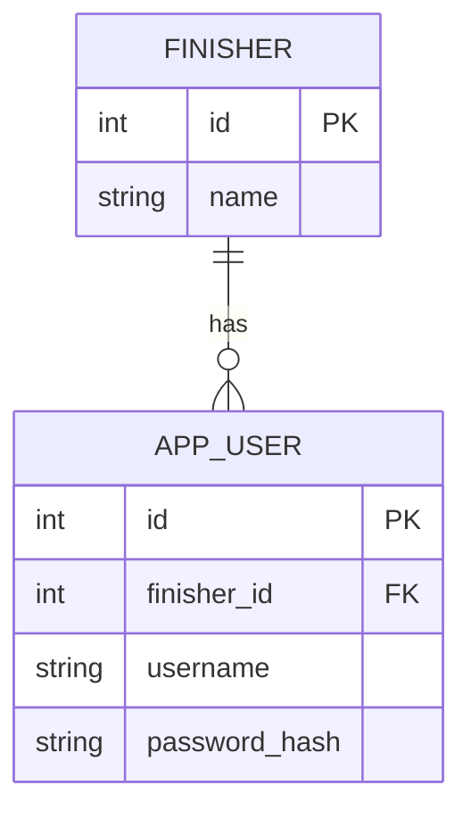
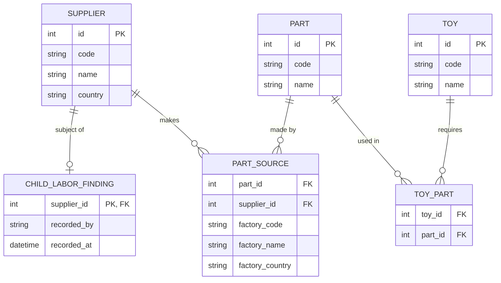
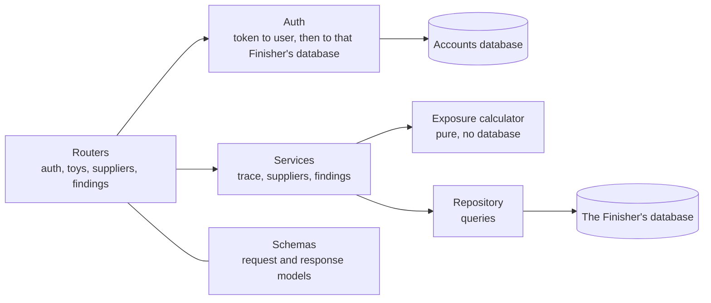

# Design

How FairToy is built. It is derived from [spec.md](spec.md): the rules live there, and the reasons for each choice live in [decisions.md](decisions.md). What the user sees is in [ux.md](ux.md), and the contract between frontend and backend is in [api.md](api.md).

## System design



Solid lines are in scope. Dotted lines are extension points and are **not built** ([D7](decisions.md#d7-basic-materials-and-purchase-records-are-out-of-scope)). Each Finisher has its own database, and a request can only open the one that belongs to the signed-in user ([D17](decisions.md#d17-isolation-is-structural-one-database-per-finisher)). A one-off seed creates and fills the databases; entering or uploading data through the app is out of scope ([D6](decisions.md#d6-data-is-seeded-not-entered)). Exposure is computed on read from the current findings ([D5](decisions.md#d5-exposure-is-computed-never-stored)).

## Sequence



## Data model

Shaped around the questions we answer, not around the CSV files: *which toys use which parts, and which suppliers can make each part?* The trace is two hops, toy to part to supplier.

The data lives in two kinds of database ([D17](decisions.md#d17-isolation-is-structural-one-database-per-finisher)):

- **Accounts database**, one for the whole app. It holds the Finishers and their users, and is used only to sign in and to find which Finisher a user belongs to.
- **Finisher database**, one per Finisher. It holds that Finisher's toys, parts, suppliers and findings. No table in it has a Finisher column: everything in the file belongs to the same Finisher.

Accounts database:



Finisher database (one per Finisher, same shape in each):



- **Users.** A user belongs to exactly one Finisher. The Finisher of every request comes from the signed-in user ([D16](decisions.md#d16-authentication-seeded-users-and-a-signed-token)).
- **Ownership.** A Finisher's toys, parts, suppliers and findings are the contents of its own database. Nothing is shared between Finishers ([D2](decisions.md#d2-all-of-a-finishers-data-belongs-to-it)), and a request opens only the database of the signed-in user's Finisher ([D17](decisions.md#d17-isolation-is-structural-one-database-per-finisher)). `code` is the Finisher's own reference (for example `TOY-0275`), shown on screen and unique within a Finisher.
- **One finding per supplier.** It is the only record the app creates. It stores the username of the user who recorded it as text, because users live in the accounts database and a foreign key cannot cross databases. Everything else is read-only seeded data ([D4](decisions.md#d4-a-finding-can-be-recorded-and-withdrawn-with-no-history), [D6](decisions.md#d6-data-is-seeded-not-entered)).
- **Factory is a detail, not a record.** Where a part is made is three plain fields on the part source (code, name, country). The code tells apart factories that share a name. Findings are not made against factories, so a factory needs no identity of its own. Factories that make no part are not kept ([D10](decisions.md#d10-model-for-the-trace-not-for-the-csv-files)).
- **Supplier, not a generic provider.** Basic Materials would add a branch below the supplier: toy, part, the supplier that makes it, then the company that supplies that supplier's material. It needs new data (companies, part-to-material, material sourcing) and is not a type value on supplier ([D7](decisions.md#d7-basic-materials-and-purchase-records-are-out-of-scope)).
- **Exposure is a query, not a table.** For a toy: take its parts, take each part's distinct suppliers, and check which of them have a finding ([D5](decisions.md#d5-exposure-is-computed-never-stored)). Two factories of the same supplier count as one supplier.

## Schema

Relational, one table per entity in the data model. Keys are integer ids; `code` is the source reference. Ids are local to one database, so the same id names a different record for another Finisher.

**Accounts database** (one for the app)

| Table | Columns | Keys and constraints |
|---|---|---|
| `finisher` | `id`, `name` | PK `id` |
| `app_user` | `id`, `finisher_id`, `username`, `password_hash` | PK `id`; FK `finisher_id`; unique `username` |

**Finisher database** (one per Finisher, the same schema in each)

| Table | Columns | Keys and constraints |
|---|---|---|
| `toy` | `id`, `code`, `name` | PK `id`; unique `code` |
| `part` | `id`, `code`, `name` | PK `id`; unique `code` |
| `supplier` | `id`, `code`, `name`, `country` | PK `id`; unique `code` |
| `toy_part` | `toy_id`, `part_id` | PK (`toy_id`, `part_id`); FKs; index on `part_id` |
| `part_source` | `id`, `part_id`, `supplier_id`, `factory_code`, `factory_name`, `factory_country` | PK `id`; FKs; unique (`part_id`, `factory_code`); index on `supplier_id` |
| `child_labor_finding` | `supplier_id`, `recorded_by`, `recorded_at` | PK `supplier_id`; FK `supplier_id` |

- All columns are required. The factory fields are always present once the blank city and address are dropped ([D9](decisions.md#d9-drop-data-the-trace-does-not-need)).
- Foreign keys are enforced. SQLite only does this when `PRAGMA foreign_keys = ON` is set on each connection, which happens in the one place connections are opened. Seeded data is never deleted. Only `child_labor_finding` is written by the app.
- A link cannot cross Finishers, because a foreign key can only point inside its own database.
- Each Finisher database is a file named after the Finisher's numeric id (for example `finisher-2.db`). The name is built from the accounts database, never from anything in the request.
- The users table is `app_user`, not `user`, because `user` is a reserved word in PostgreSQL.

## Seed

A one-off command that creates the accounts database and one database per Finisher. It is part of the deliverable ([D6](decisions.md#d6-data-is-seeded-not-entered)).

1. **Finishers and users.** In the accounts database: one Finisher per row of `finishers.csv`, and one user per Finisher. The username is the Finisher's name in lower case, with every run of other characters replaced by one hyphen (`Kestrel Play` gives `kestrel-play`, `Arbor & Finch` gives `arbor-finch`). All demo users share one password, listed in the README and stored only as a hash.
2. **One database per Finisher.** Each is created with the same schema and then filled with that Finisher's data only (steps 3 to 5).
3. **Toys.** One toy per row of `toys.csv` for that Finisher. A toy code listed by two Finishers becomes a separate toy in each one's database, with the same parts.
4. **Parts and suppliers.** One part per part code the Finisher's toys use, and one supplier per supplier that makes any of those parts. A supplier that makes no used part is not kept. In the sample data that is only SUP-038, which has no factories and no parts.
5. **Links.** One `toy_part` per BOM line of each toy; one `part_source` per `parts.csv` row of each of the Finisher's parts, with the factory's code, name and country copied in.
6. **Dropped.** The columns listed in [D9](decisions.md#d9-drop-data-the-trace-does-not-need).
7. **Safety.** It stops with a clear message on a broken reference, including a part row whose supplier does not own its factory. It refuses to run if any of the databases already exists, so findings are never wiped by accident. The CSV files are only read.

For the sample data, the eight Finisher databases together hold 305 toys, 3,079 parts, 392 suppliers, 3,250 part sources and 10,648 toy-part links. A test of the seed checks these totals.

Ids are internal and unrelated to codes.

## Backend components



| Component | Responsibility | Knows nothing about |
|---|---|---|
| Routers | HTTP: paths, parameters, status codes, error shape | Exposure rules, SQL |
| Auth | Checks credentials and issues the token; turns a request's token into the current user, and hands the request a connection to that user's Finisher database, or refuses with 401. The only component that knows there is more than one Finisher | Exposure rules |
| Schemas | The API contract as typed models ([api.md](api.md)) | Storage |
| Services | One use case each: build a toy trace, list suppliers and the toys each reaches, record or withdraw a finding | HTTP |
| Exposure calculator | The spec's exposure rule, as a pure function | Database, HTTP |
| Repository | The few queries that fetch facts and the two writes, on the connection it is given | Exposure rules, other Finishers |

**Isolation rule:** no router reads a Finisher from the request, and no service or repository function takes a Finisher id at all. The auth component turns the token into a user, looks up that user's Finisher in the accounts database, and hands the request one connection to that Finisher's database. Everything after that works on that connection. A query that forgets a filter still cannot return another Finisher's rows, because they are not in the file ([D17](decisions.md#d17-isolation-is-structural-one-database-per-finisher), [D11](decisions.md#d11-the-api-is-scoped-by-the-signed-in-user-and-findings-are-an-idempotent-sub-resource)). The one place that can get this wrong is the function that picks the database for a user, so it is a single small function with its own tests.

Rule: dependencies point one way, routers to services to calculator and repository. The rules in the spec live in exactly one place, the calculator ([D12](decisions.md#d12-exposure-is-calculated-in-the-backend-by-a-pure-function)).

### Exposure calculator

- **Input:** for each toy, its parts, and for each part the set of its supplier ids; plus the set of supplier ids this Finisher has findings against.
- **Output:** an exposure for each part and for the toy.
- **Part:** `affected` if every supplier of the part is implicated; `possibly_affected` if some are; otherwise `no_finding`. A part with no suppliers is `no_finding`.
- **Toy:** the most severe of its parts.
- **Preview:** the same function called with the implicated set plus one supplier gives `exposureIfFlagged`.

One request loads a Finisher's facts with a single query (a few thousand rows) and the calculator does the rest.

## Frontend components

```text
App shell                 top bar: Finisher name, user, sign out, Toys / Suppliers tabs
  LoginPage               shown whenever there is no valid token
  ToysPage
    ExposureSummary       the three counts
    ExposureFilter        All / Affected / Possibly affected / No finding
    SearchBox
    ToyTable
  ToyTracePage
    TraceHeader           toy, exposure, one-sentence why
    PartTrace             one part and its possible sources
    CollapsedParts        parts with no finding
  SuppliersPage
    SupplierTable         with flag / withdraw buttons
    SupplierDetail        reached toys, exposure now
  FlagDialog              consequence preview, confirm
  Shared
    ExposureBadge         word + symbol + color
    UndoMessage           after a flag
    EmptyState, ErrorState, Skeleton
```

State: the server is the source of truth. After a flag or a withdraw the affected queries are refetched. The token is kept for the browser session and sent with every request. A 401 from the API sends the user back to the login page.

## Stack

| Layer | Choice | Why |
|---|---|---|
| API | Python, FastAPI | The assignment asks for Python; typed models double as the API contract and documentation |
| Database | SQLite | One file per Finisher plus one for accounts, no server to install; each Finisher has a few thousand rows and one writer |
| Frontend | React, TypeScript, Vite | The assignment asks for React; types catch contract drift |
| Frontend data | A query library with refetch on change | Server state is the source of truth |

See [D14](decisions.md#d14-stack-fastapi-sqlite-react-with-typescript).

## Checking it

- The exposure calculator is unit-tested against the rules in the spec, including a part with two suppliers and a part with none.
- API tests cover the acceptance checklist in the spec, especially idempotent record and withdraw.
- **Isolation tests**, since this is what is assessed:
  - Every data endpoint refuses a request with no token or a bad one.
  - Each user's toy list is exactly its Finisher's rows of `toys.csv`, and each Finisher database holds only the parts and suppliers those toys reach.
  - Two users of different Finishers call the same URLs with the same ids and each gets only their own records.
  - A finding recorded by Finisher A leaves Finisher B's database unchanged, including B's supplier with the same code and id, and B cannot withdraw it.
  - The function that picks the database returns the right file for each user and cannot be steered by anything in the request.
- One end-to-end pass follows the walkthrough in [ux.md](ux.md).

## What breaks first as this grows

1. **Exposure is recomputed for the whole catalog on every read.** Fine for dozens of toys and a few thousand rows. With thousands of toys, the first step is to compute only what the page shows; the next is to keep a per-toy result that is refreshed when a finding changes. The calculator stays the same either way.
2. **Lists are returned whole.** Toys and suppliers need server-side paging, filtering and search once a Finisher has hundreds of them.
3. **One database per Finisher.** Right for isolation, and fine for tens or hundreds of Finishers. With thousands, every schema change has to be applied to every file, and connections and backups multiply. SQLite also allows one writer per file, which here means one writer per Finisher. The same idea moves to a server database as one schema per Finisher or as row-level security, with the request still bound to one Finisher by the auth component.
4. **Authentication.** Tokens cannot be revoked and there is one role. Real use needs token revocation or sessions, roles, and an identity provider.
5. **No view across Finishers.** That is right for isolation, but FairToy itself cannot see that several Finishers flagged the same real company. That would need a separate reporting copy and a way to match suppliers.

## Not designed yet

Run instructions, the visual design (colors, spacing), and test details beyond the above.
