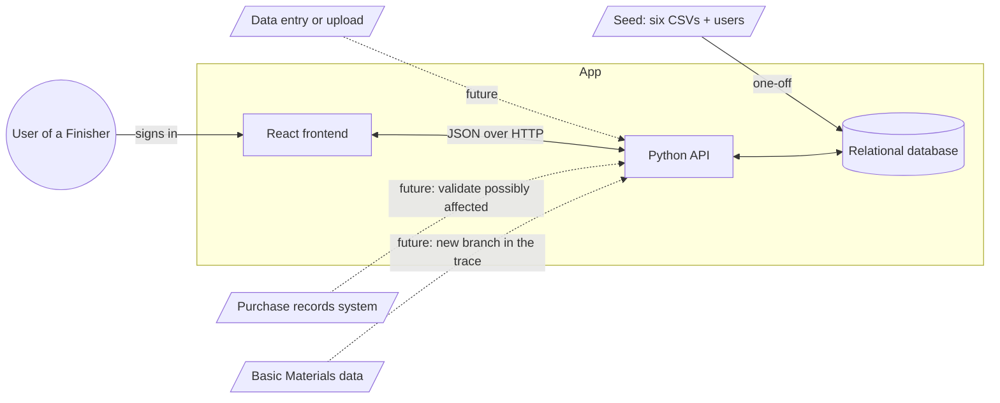
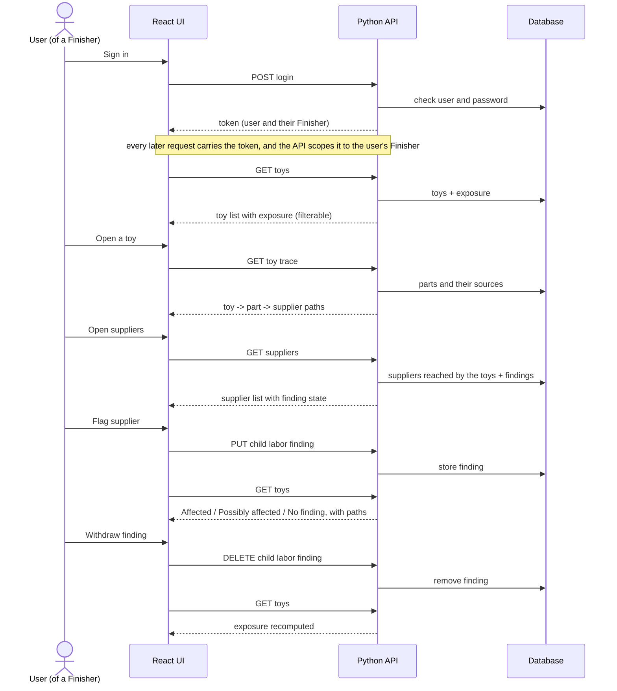
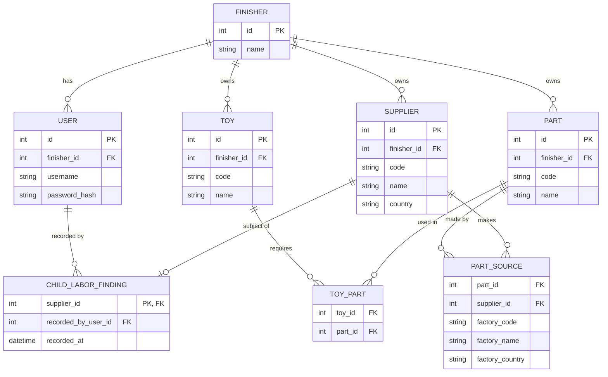
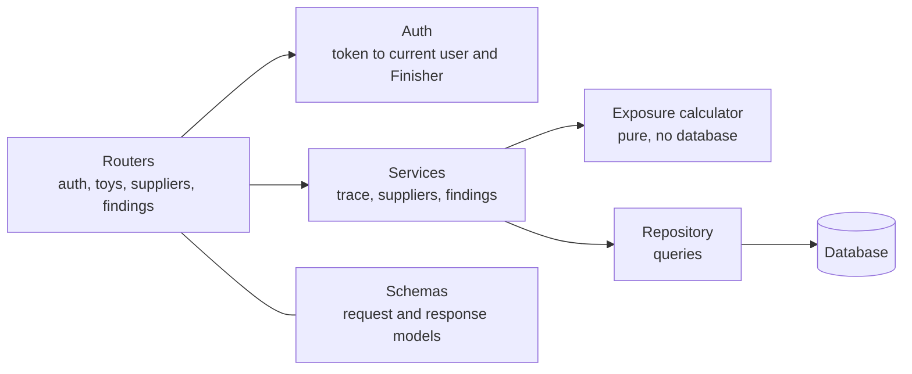

# Design

How FairToy is built. It is derived from [spec.md](spec.md): the rules live there, and the reasons for each choice live in [decisions.md](decisions.md). What the user sees is in [ux.md](ux.md), and the contract between frontend and backend is in [api.md](api.md).

## System design



Solid lines are in scope. Dotted lines are extension points and are **not built** ([D7](decisions.md#d7-basic-materials-and-purchase-records-are-out-of-scope)). A one-off seed fills the database; entering or uploading data through the app is out of scope ([D6](decisions.md#d6-data-is-seeded-not-entered)). Exposure is computed on read from the current findings ([D5](decisions.md#d5-exposure-is-computed-never-stored)).

## Sequence



## Data model

Shaped around the questions we answer, not around the CSV files: *which toys use which parts, and which suppliers can make each part?* The trace is two hops, toy to part to supplier.



- **Users.** A user belongs to exactly one Finisher. The Finisher of every request comes from the signed-in user ([D16](decisions.md#d16-authentication-seeded-users-and-a-signed-token)).
- **Ownership.** Toy, part and supplier each belong to one Finisher and carry its id. Links and findings inherit it through what they point at. Nothing is shared between Finishers ([D2](decisions.md#d2-all-of-a-finishers-data-belongs-to-it)). `code` is the Finisher's own reference (for example `TOY-0275`), shown on screen and unique within a Finisher.
- **One finding per supplier.** A supplier belongs to one Finisher, so its finding does too. It is the only record the app creates, and it records which user made it. Everything else is read-only seeded data ([D4](decisions.md#d4-a-finding-can-be-recorded-and-withdrawn-with-no-history), [D6](decisions.md#d6-data-is-seeded-not-entered)).
- **Factory is a detail, not a record.** Where a part is made is three plain fields on the part source (code, name, country). The code tells apart factories that share a name. Findings are not made against factories, so a factory needs no identity of its own. Factories that make no part are not kept ([D10](decisions.md#d10-model-for-the-trace-not-for-the-csv-files)).
- **Supplier, not a generic provider.** Basic Materials would add a branch below the supplier: toy, part, the supplier that makes it, then the company that supplies that supplier's material. It needs new data (companies, part-to-material, material sourcing) and is not a type value on supplier ([D7](decisions.md#d7-basic-materials-and-purchase-records-are-out-of-scope)).
- **Exposure is a query, not a table.** For a toy: take its parts, take each part's distinct suppliers, and check which of them have a finding ([D5](decisions.md#d5-exposure-is-computed-never-stored)). Two factories of the same supplier count as one supplier.

## Schema

Relational, one table per entity in the data model. Keys are integer ids; `code` is the source reference.

| Table | Columns | Keys and constraints |
|---|---|---|
| `finisher` | `id`, `name` | PK `id` |
| `user` | `id`, `finisher_id`, `username`, `password_hash` | PK `id`; FK `finisher_id`; unique `username` |
| `toy` | `id`, `finisher_id`, `code`, `name` | PK `id`; FK `finisher_id`; unique (`finisher_id`, `code`) |
| `part` | `id`, `finisher_id`, `code`, `name` | PK `id`; FK `finisher_id`; unique (`finisher_id`, `code`) |
| `supplier` | `id`, `finisher_id`, `code`, `name`, `country` | PK `id`; FK `finisher_id`; unique (`finisher_id`, `code`) |
| `toy_part` | `toy_id`, `part_id` | PK (`toy_id`, `part_id`); FKs; index on `part_id` |
| `part_source` | `id`, `part_id`, `supplier_id`, `factory_code`, `factory_name`, `factory_country` | PK `id`; FKs; unique (`part_id`, `factory_code`); index on `supplier_id` |
| `child_labor_finding` | `supplier_id`, `recorded_by_user_id`, `recorded_at` | PK `supplier_id`; FKs |

- All columns are required. The factory fields are always present once the blank city and address are dropped ([D9](decisions.md#d9-drop-data-the-trace-does-not-need)).
- Foreign keys are enforced and seeded data is never deleted. Only `child_labor_finding` is written by the app.
- A link never crosses Finishers: a toy's parts, a part's suppliers and a finding's user all belong to the same Finisher. The seed guarantees it and a test checks it. Enforcing it in the database with composite keys is the hardening step once Finishers can enter data.

## Seed

A one-off command that fills an empty database. It is part of the deliverable ([D6](decisions.md#d6-data-is-seeded-not-entered)).

1. **Finishers and users.** One Finisher per row of `finishers.csv`, and one user per Finisher. The username is derived from the Finisher's name (for example `kestrel-play`). All demo users share one password, listed in the README and stored only as a hash.
2. **Toys.** One toy per row of `toys.csv`. A toy code listed by two Finishers becomes two toys, and both get the same parts.
3. **Parts and suppliers, per Finisher.** For each Finisher, one part per part code its toys use, and one supplier per supplier that makes any of those parts. The same code therefore exists once per Finisher that uses it. A supplier that makes no used part is not kept.
4. **Links, within the Finisher.** One `toy_part` per BOM line of each toy; one `part_source` per `parts.csv` row of each of the Finisher's parts, with the factory's code, name and country copied in.
5. **Dropped.** The columns listed in [D9](decisions.md#d9-drop-data-the-trace-does-not-need).
6. **Safety.** It stops with a clear message on a broken reference, and refuses to run on a database that already has data, so findings are never wiped by accident. The CSV files are only read.

Ids are internal and unrelated to codes.

## Backend components



| Component | Responsibility | Knows nothing about |
|---|---|---|
| Routers | HTTP: paths, parameters, status codes, error shape | Exposure rules, SQL |
| Auth | Checks credentials and issues the token; turns a request's token into the current user and their Finisher, or refuses with 401 | Exposure rules |
| Schemas | The API contract as typed models ([api.md](api.md)) | Storage |
| Services | One use case each: build a toy trace, list suppliers and the toys each reaches, record or withdraw a finding | HTTP |
| Exposure calculator | The spec's exposure rule, as a pure function | Database, HTTP |
| Repository | The few queries that fetch facts and the two writes | Exposure rules |

**Isolation rule:** no router reads a Finisher from the request. Every service and repository function takes the Finisher id from the auth component as a required argument, and every query starts from a table that carries it (toy, part or supplier), so a query cannot be written without it ([D11](decisions.md#d11-the-api-is-scoped-by-the-signed-in-user-and-findings-are-an-idempotent-sub-resource)).

Rule: dependencies point one way, routers to services to calculator and repository. The rules in the spec live in exactly one place, the calculator ([D12](decisions.md#d12-exposure-is-calculated-in-the-backend-by-a-pure-function)).

### Exposure calculator

- **Input:** for each toy, its parts, and for each part the set of its supplier ids; plus the set of supplier ids this Finisher has findings against.
- **Output:** an exposure for each part and for the toy.
- **Part:** `affected` if every supplier of the part is implicated; `possibly_affected` if some are; otherwise `no_finding`. A part with no suppliers is `no_finding`.
- **Toy:** the most severe of its parts.
- **Preview:** the same function called with the implicated set plus one supplier gives `exposureIfFlagged`.

One request loads a Finisher's facts with a single query (a few thousand rows) and the calculator does the rest.

## Frontend components

```text
App shell                 top bar: Finisher name, user, sign out, Toys / Suppliers tabs
  LoginPage               shown whenever there is no valid token
  ToysPage
    ExposureSummary       the three counts
    ExposureFilter        All / Affected / Possibly affected / No finding
    SearchBox
    ToyTable
  ToyTracePage
    TraceHeader           toy, exposure, one-sentence why
    PartTrace             one part and its possible sources
    CollapsedParts        parts with no finding
  SuppliersPage
    SupplierTable         with flag / withdraw buttons
    SupplierDetail        reached toys, exposure now
  FlagDialog              consequence preview, confirm
  Shared
    ExposureBadge         word + symbol + color
    UndoMessage           after a flag
    EmptyState, ErrorState, Skeleton
```

State: the server is the source of truth. After a flag or a withdraw the affected queries are refetched. The token is kept for the browser session and sent with every request. A 401 from the API sends the user back to the login page.

## Stack

| Layer | Choice | Why |
|---|---|---|
| API | Python, FastAPI | The assignment asks for Python; typed models double as the API contract and documentation |
| Database | SQLite | One file, no server to install; the data is a few thousand rows and one writer |
| Frontend | React, TypeScript, Vite | The assignment asks for React; types catch contract drift |
| Frontend data | A query library with refetch on change | Server state is the source of truth |

See [D14](decisions.md#d14-stack-fastapi-sqlite-react-with-typescript).

## Checking it

- The exposure calculator is unit-tested against the rules in the spec, including a part with two suppliers and a part with none.
- API tests cover the acceptance checklist in the spec, especially idempotent record and withdraw.
- **Isolation tests**, since this is what is assessed: every data endpoint refuses a request with no token or a bad one; a user of Finisher A gets 404 for a toy of Finisher B; A's findings never appear for B, and B cannot withdraw them; a supplier or part of Finisher B answers 404 for A, and A cannot flag it.
- One end-to-end pass follows the walkthrough in [ux.md](ux.md).

## What breaks first as this grows

1. **Exposure is recomputed for the whole catalog on every read.** Fine for dozens of toys and a few thousand rows. With thousands of toys, the first step is to compute only what the page shows; the next is to keep a per-toy result that is refreshed when a finding changes. The calculator stays the same either way.
2. **Lists are returned whole.** Toys and suppliers need server-side paging, filtering and search once a Finisher has hundreds of them.
3. **SQLite has one writer.** Many Finishers recording findings at once need a server database. Only findings are written, so the move is small.
4. **Authentication.** Tokens cannot be revoked and there is one role. Real use needs token revocation or sessions, roles, and an identity provider.
5. **The same supplier exists once per Finisher.** That is right for isolation, but FairToy itself cannot see that several Finishers flagged the same real company. A cross-Finisher view would need a way to match them.

## Not designed yet

Run instructions, the visual design (colors, spacing), and test details beyond the above.
