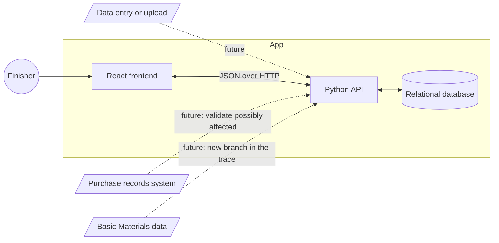
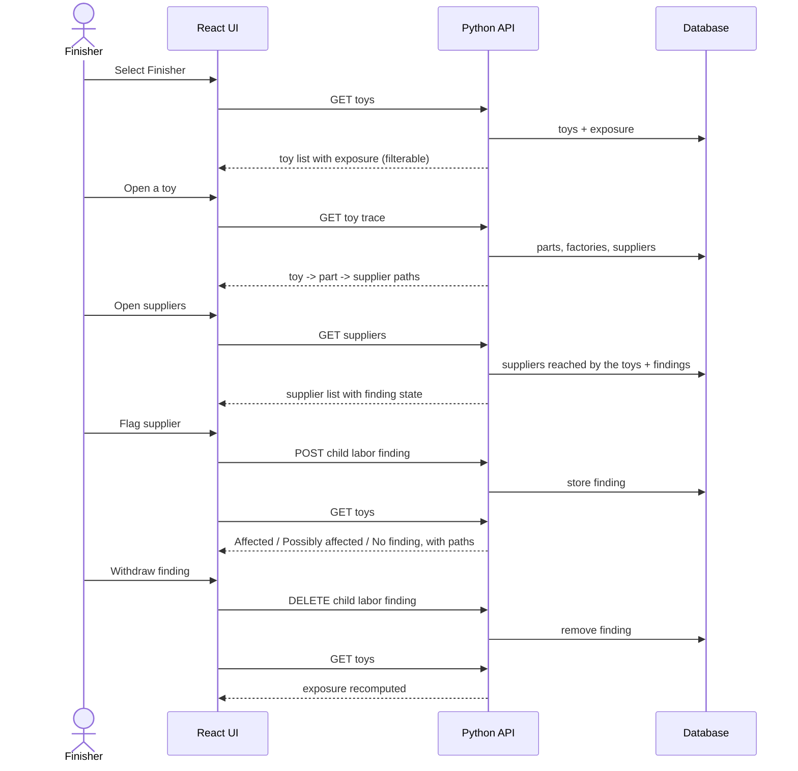
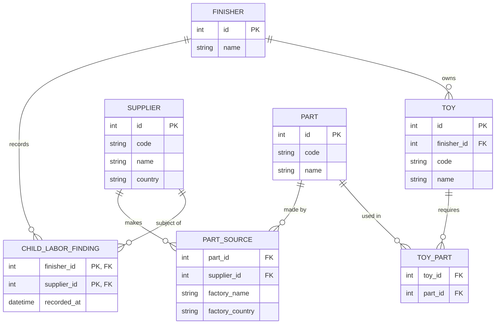

# Design

How FairToy is built. It is derived from [spec.md](spec.md): the rules live there, and the reasons for each choice live in [decisions.md](decisions.md).

## System design

Solid lines are in scope. Dotted lines are extension points and are **not built** ([D7](decisions.md#d7-basic-materials-and-purchase-records-are-out-of-scope)). The database is assumed to already hold the data; entering or uploading it is out of scope ([D6](decisions.md#d6-data-is-assumed-already-loaded)). Exposure is computed on read from the current findings ([D5](decisions.md#d5-exposure-is-computed-never-stored)).

## Sequence

## Data model

Shaped around the questions we answer, not around the CSV files: *which toys use which parts, and which suppliers can make each part?* The trace is two hops, toy to part to supplier.

- **Ownership.** Only the toy and the finding belong to a Finisher. Parts and suppliers are shared, read-only reference data with no owner. A Finisher's world is what its toys reach: toy, then parts, then suppliers ([D2](decisions.md#d2-findings-belong-to-the-finisher-reference-data-is-shared)). `code` is the source reference (for example `TOY-0275`), shown on screen.
- **The finding is keyed by Finisher and supplier.** A Finisher has at most one finding per supplier, and one Finisher's findings never appear in another's view. It is the only record the app creates. Everything else is read-only data assumed to be in place ([D4](decisions.md#d4-a-finding-can-be-recorded-and-withdrawn-with-no-history), [D6](decisions.md#d6-data-is-assumed-already-loaded)).
- **Factory is a detail, not a record.** Where a part is made is two plain fields on the part source. Findings are not made against factories, so a factory needs no identity of its own. Factories that make no part are not kept ([D10](decisions.md#d10-model-for-the-trace-not-for-the-csv-files)).
- **Supplier, not a generic provider.** Basic Materials would add a branch below the supplier: toy, part, the supplier that makes it, then the company that supplies that supplier's material. It needs new data (companies, part-to-material, material sourcing) and is not a type value on supplier ([D7](decisions.md#d7-basic-materials-and-purchase-records-are-out-of-scope)).
- **Exposure is a query, not a table.** For a toy: take its parts, take each part's distinct suppliers, and check which of them this Finisher has a finding against ([D5](decisions.md#d5-exposure-is-computed-never-stored)). Two factories of the same supplier count as one supplier.

## Not designed yet

API, technology choices and the UI. These come next.
