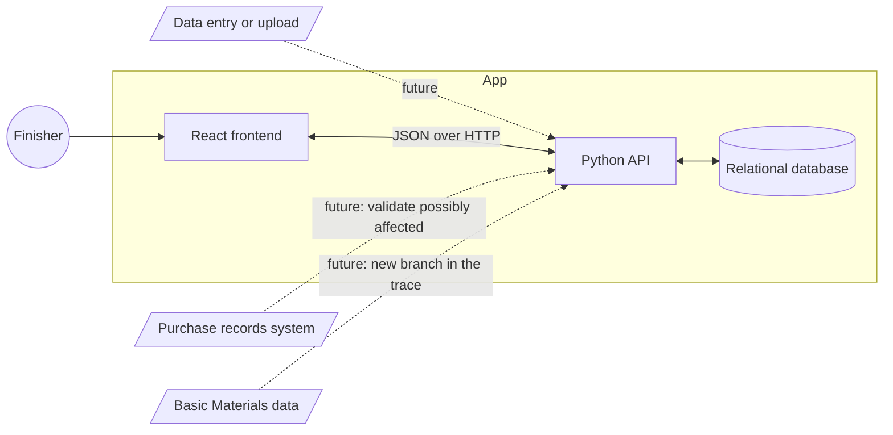
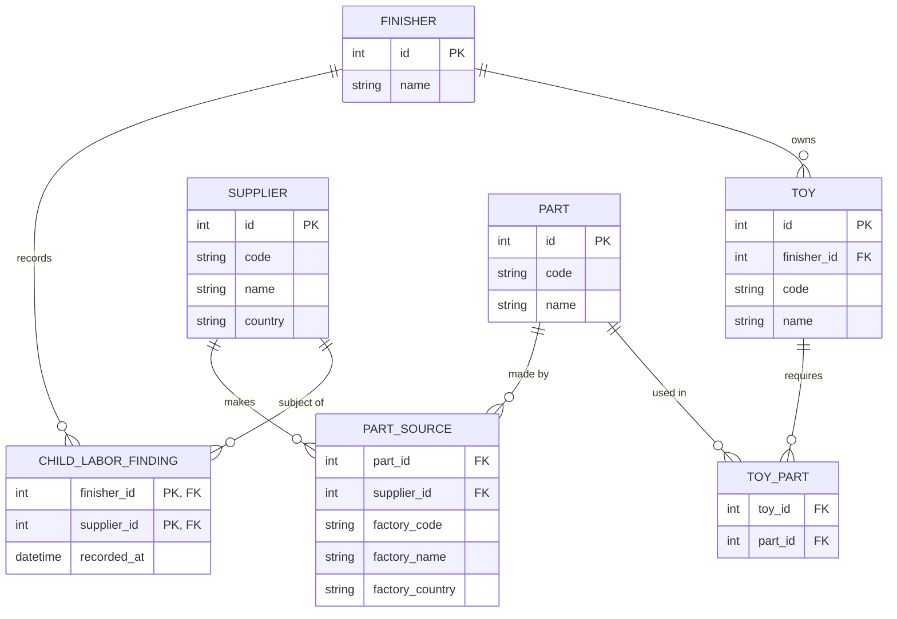
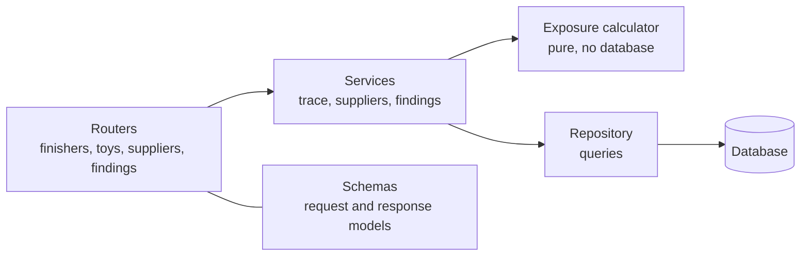

# Design

How FairToy is built. It is derived from [spec.md](spec.md): the rules live there, and the reasons for each choice live in [decisions.md](decisions.md). What the user sees is in [ux.md](ux.md), and the contract between frontend and backend is in [api.md](api.md).

## System design



Solid lines are in scope. Dotted lines are extension points and are **not built** ([D7](decisions.md#d7-basic-materials-and-purchase-records-are-out-of-scope)). The database is assumed to already hold the data; entering or uploading it is out of scope ([D6](decisions.md#d6-data-is-assumed-already-loaded)). Exposure is computed on read from the current findings ([D5](decisions.md#d5-exposure-is-computed-never-stored)).

## Sequence


## Data model

Shaped around the questions we answer, not around the CSV files: *which toys use which parts, and which suppliers can make each part?* The trace is two hops, toy to part to supplier.



- **Ownership.** Only the toy and the finding belong to a Finisher. Parts and suppliers are shared, read-only reference data with no owner. A Finisher's world is what its toys reach: toy, then parts, then suppliers ([D2](decisions.md#d2-findings-belong-to-the-finisher-reference-data-is-shared)). `code` is the source reference (for example `TOY-0275`), shown on screen.
- **The finding is keyed by Finisher and supplier.** A Finisher has at most one finding per supplier, and one Finisher's findings never appear in another's view. It is the only record the app creates. Everything else is read-only data assumed to be in place ([D4](decisions.md#d4-a-finding-can-be-recorded-and-withdrawn-with-no-history), [D6](decisions.md#d6-data-is-assumed-already-loaded)).
- **Factory is a detail, not a record.** Where a part is made is three plain fields on the part source (code, name, country). The code tells apart factories that share a name. Findings are not made against factories, so a factory needs no identity of its own. Factories that make no part are not kept ([D10](decisions.md#d10-model-for-the-trace-not-for-the-csv-files)).
- **Supplier, not a generic provider.** Basic Materials would add a branch below the supplier: toy, part, the supplier that makes it, then the company that supplies that supplier's material. It needs new data (companies, part-to-material, material sourcing) and is not a type value on supplier ([D7](decisions.md#d7-basic-materials-and-purchase-records-are-out-of-scope)).
- **Exposure is a query, not a table.** For a toy: take its parts, take each part's distinct suppliers, and check which of them this Finisher has a finding against ([D5](decisions.md#d5-exposure-is-computed-never-stored)). Two factories of the same supplier count as one supplier.

## Schema

Relational, one table per entity in the data model. Keys are integer ids; `code` is the source reference.

| Table | Columns | Keys and constraints |
|---|---|---|
| `finisher` | `id`, `name` | PK `id` |
| `toy` | `id`, `finisher_id`, `code`, `name` | PK `id`; FK `finisher_id`; unique (`finisher_id`, `code`) |
| `part` | `id`, `code`, `name` | PK `id`; unique `code` |
| `supplier` | `id`, `code`, `name`, `country` | PK `id`; unique `code` |
| `toy_part` | `toy_id`, `part_id` | PK (`toy_id`, `part_id`); FKs; index on `part_id` |
| `part_source` | `id`, `part_id`, `supplier_id`, `factory_code`, `factory_name`, `factory_country` | PK `id`; FKs; unique (`part_id`, `factory_code`); index on `supplier_id` |
| `child_labor_finding` | `finisher_id`, `supplier_id`, `recorded_at` | PK (`finisher_id`, `supplier_id`); FKs |

- All columns are required. The factory fields are always present once the blank city and address are dropped ([D9](decisions.md#d9-drop-data-the-trace-does-not-need)).
- Foreign keys are enforced and reference data is never deleted. Only `child_labor_finding` is written by the app.
- The data is assumed to be in place ([D6](decisions.md#d6-data-is-assumed-already-loaded)). Preparing the sample dataset is a one-off script outside the product's features and is not designed here. One rule it must follow: a toy code listed by two Finishers becomes two toys, and both get the same parts. Ids are internal and unrelated to codes.

## Backend components



| Component | Responsibility | Knows nothing about |
|---|---|---|
| Routers | HTTP: paths, parameters, status codes, error shape | Exposure rules, SQL |
| Schemas | The API contract as typed models ([api.md](api.md)) | Storage |
| Services | One use case each: build a toy trace, list suppliers with reach, record or withdraw a finding | HTTP |
| Exposure calculator | The spec's exposure rule, as a pure function | Database, HTTP |
| Repository | The few queries that fetch facts and the two writes | Exposure rules |

Rule: dependencies point one way, routers to services to calculator and repository. The rules in the spec live in exactly one place, the calculator ([D12](decisions.md#d12-exposure-is-calculated-in-the-backend-by-a-pure-function)).

### Exposure calculator

- **Input:** for each toy, its parts, and for each part the set of its supplier ids; plus the set of supplier ids this Finisher has findings against.
- **Output:** an exposure for each part and for the toy.
- **Part:** `affected` if every supplier of the part is implicated; `possibly_affected` if some are; otherwise `no_finding`. A part with no suppliers is `no_finding`.
- **Toy:** the most severe of its parts.
- **Preview:** the same function called with the implicated set plus one supplier gives `exposureIfFlagged`.

One request loads a Finisher's facts with a single query (a few thousand rows) and the calculator does the rest.

## Frontend components

```text
App shell                 top bar: Finisher selector, Toys / Suppliers tabs
  FinisherPicker          first visit
  ToysPage
    ExposureSummary       the three counts
    ExposureFilter        All / Affected / Possibly affected / No finding
    SearchBox
    ToyTable
  ToyTracePage
    TraceHeader           toy, exposure, one-sentence why
    PartTrace             one part and its possible sources
    CollapsedParts        parts with no finding
  SuppliersPage
    SupplierTable         with flag / withdraw buttons
    SupplierDetail        reached toys, exposure now
  FlagDialog              consequence preview, confirm
  Shared
    ExposureBadge         word + symbol + color
    UndoMessage           after a flag
    EmptyState, ErrorState, Skeleton
```

State: the server is the source of truth. After a flag or a withdraw the affected queries are refetched. The selected Finisher is in the URL, not in client storage.

## Stack

| Layer | Choice | Why |
|---|---|---|
| API | Python, FastAPI | The assignment asks for Python; typed models double as the API contract and documentation |
| Database | SQLite | One file, no server to install; the data is a few thousand rows and one writer |
| Frontend | React, TypeScript, Vite | The assignment asks for React; types catch contract drift |
| Frontend data | A query library with refetch on change | Server state is the source of truth |

See [D14](decisions.md#d14-stack-fastapi-sqlite-react-with-typescript).

## Checking it

- The exposure calculator is unit-tested against the rules in the spec, including a part with two suppliers and a part with none.
- API tests cover the acceptance checklist in the spec, especially per-Finisher isolation and idempotent record and withdraw.
- One end-to-end pass follows the walkthrough in [ux.md](ux.md).

## What breaks first as this grows

1. **Exposure is recomputed for the whole catalog on every read.** Fine for dozens of toys and a few thousand rows. With thousands of toys, the first step is to compute only what the page shows; the next is to keep a per-toy result that is refreshed when a finding changes. The calculator stays the same either way.
2. **Lists are returned whole.** Toys and suppliers need server-side paging, filtering and search once a Finisher has hundreds of them.
3. **SQLite has one writer.** Many Finishers recording findings at once need a server database. Only findings are written, so the move is small.
4. **Shared reference data.** Once Finishers enter their own data, parts and suppliers need an owner, which reopens D2.

## Not designed yet

Run instructions, the visual design (colors, spacing), and test details beyond the above.
