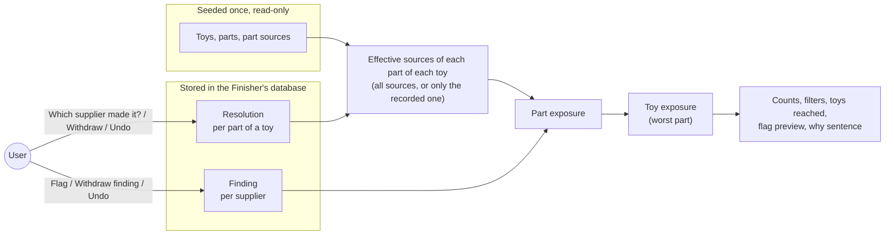
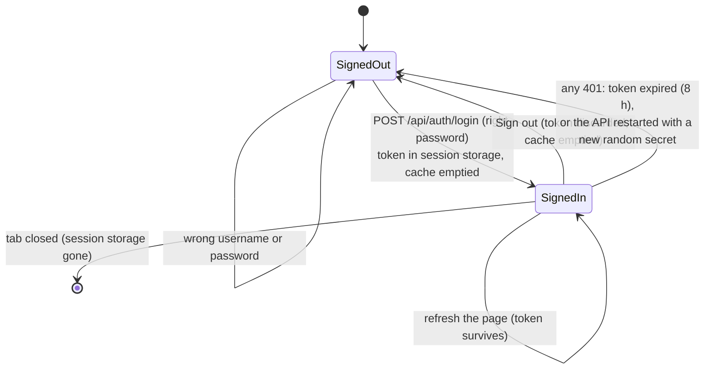
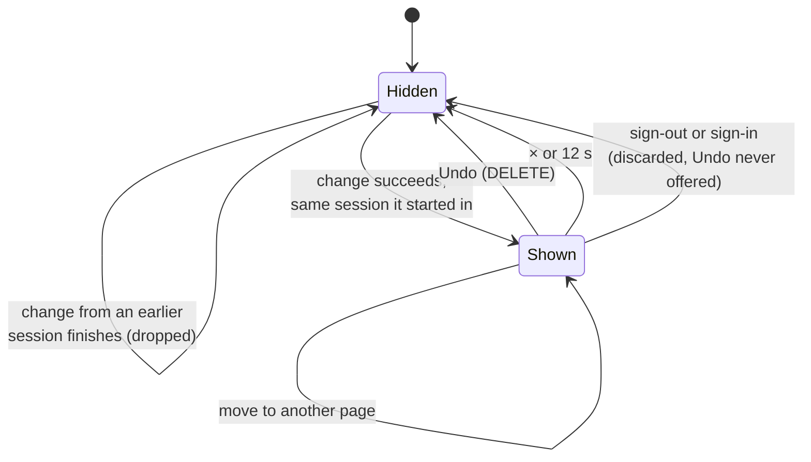
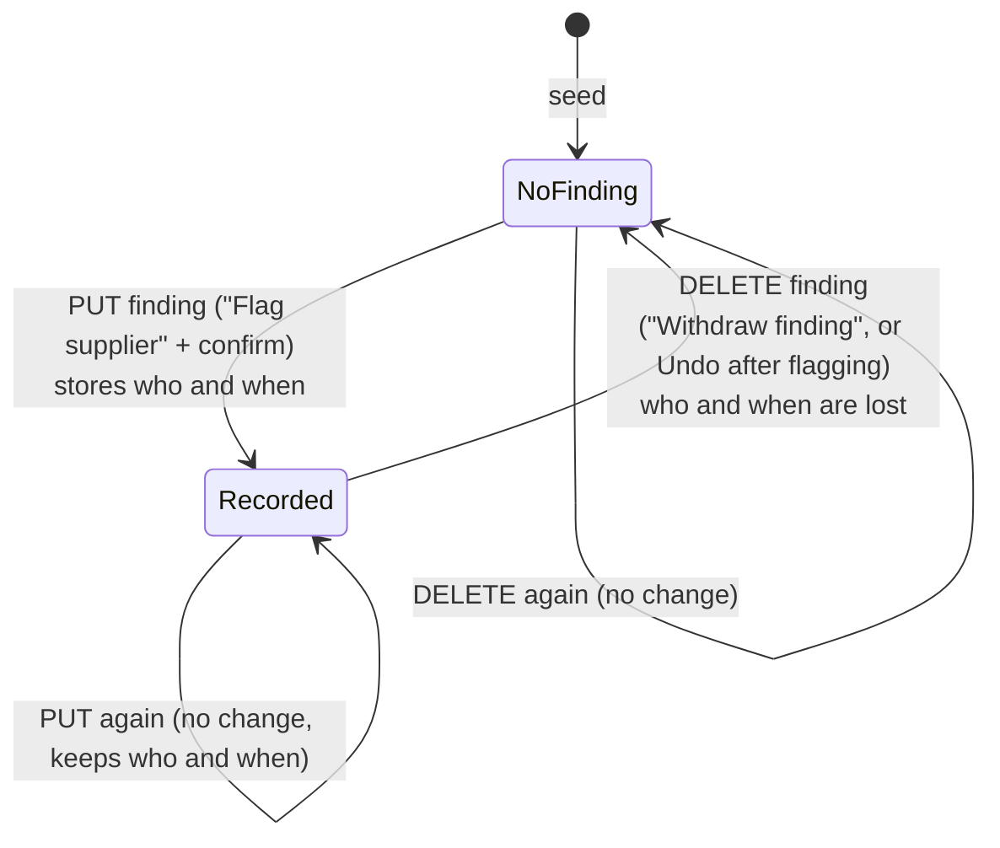
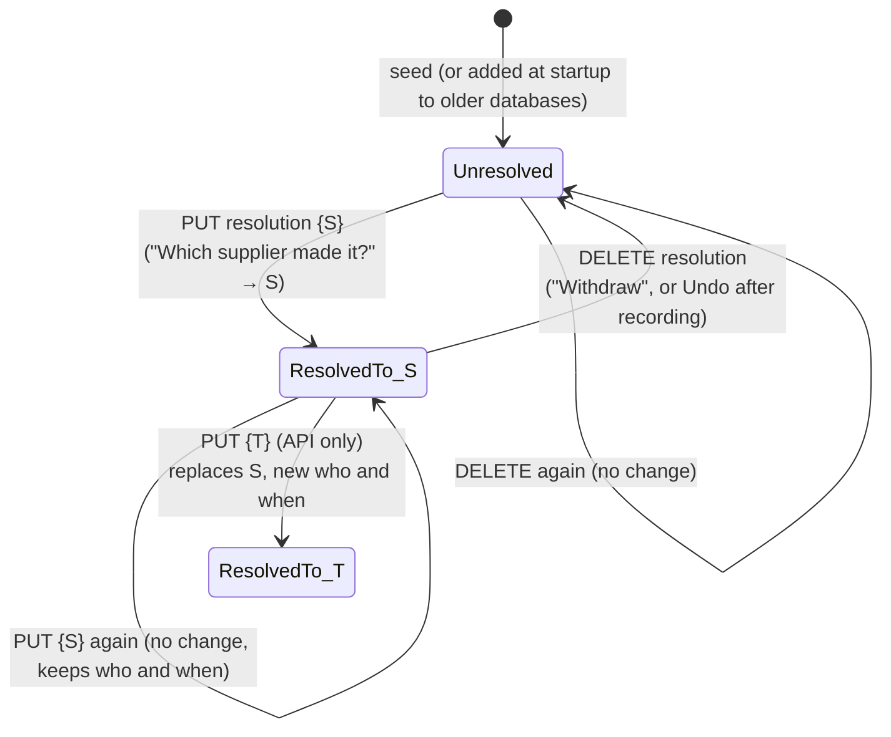
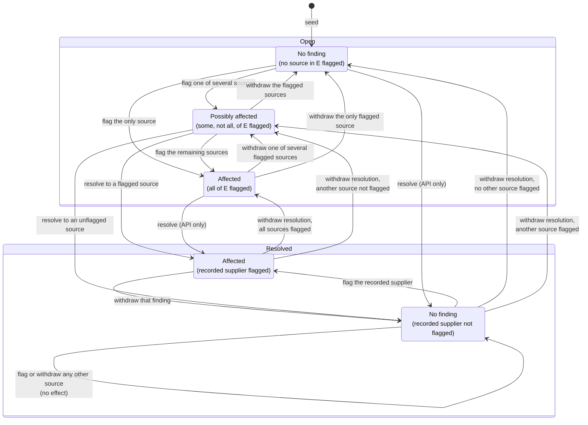
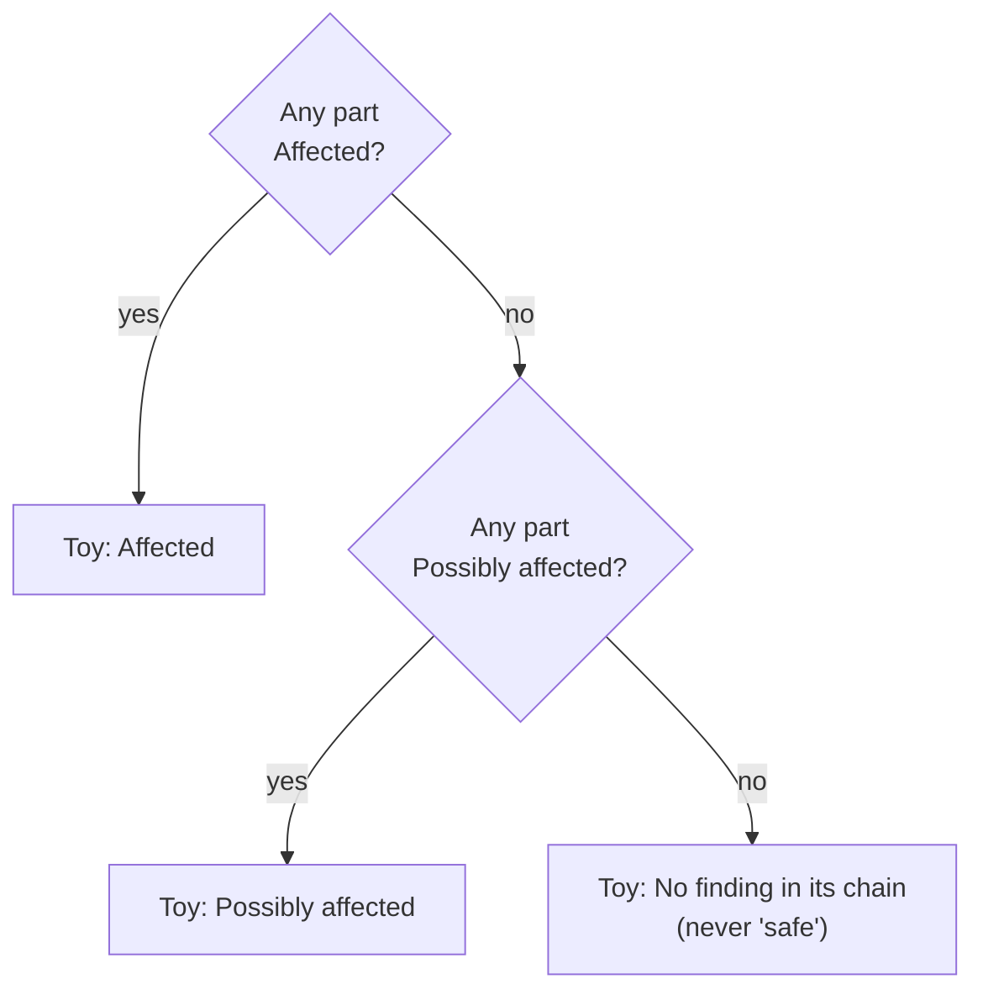

# State machine

FairToy read from the code as a set of state machines. Each diagram names the request or button that moves it. It describes what the code does today. See [spec.md](spec.md) for the rules and [api.md](api.md) for the requests.

There are only two things the app stores and changes: **findings** (one per supplier) and **resolutions** (one per part of a toy). Everything else either is seeded once, or is **derived** on every read: the exposure of a part and of a toy, the counts, toys reached, the flag preview. The session, and the confirmation with Undo that follows a change, are two small machines in the browser.

## The whole picture

## 1. Session (browser)

On every request the API maps the token to a user and the user to one Finisher database. There is no state in which a request can reach another Finisher's file.

Every sign-in and every sign-out starts a new **session** in the browser (a counter in `auth.tsx`). The query cache is emptied at each change, and the session decides whether a pending Undo may still be offered (below).

### Confirmation with Undo (browser)

After a flag or a resolution, a confirmation at the bottom of the screen offers Undo. Undo sends a `DELETE` for the record's id, and ids only mean something inside one Finisher's database: the same id names a different record for another Finisher. So a confirmation belongs to the session the change **started** in (`notice.tsx`, `findings.ts`):

The check is made while rendering as well, so there is not even one frame in which a new user could see the previous user's Undo. The end-to-end tests cover it: Kestrel Play flags a supplier, signs out, and Moonpath Brands signs in on the same tab within the 12 seconds; no confirmation appears, and Kestrel Play's finding is untouched.

## 2. Finding (one per supplier, per Finisher)

Any user of the Finisher can do any of these. There is no other state: no "cleared", no "under review", no history.

## 3. Resolution (one per part of one toy, per Finisher)

Only for a part with two or more possible suppliers. For a part with one, `PUT` answers `single_source` and there is no machine.

The UI only offers "Which supplier made it?" on an **unresolved, possibly affected** part. The API accepts a resolution on any multi-source part, whatever its exposure.

## 4. Part exposure (derived, never stored)

The exposure of one part of one toy follows from its **effective sources** E (all possible suppliers, or only the recorded one once resolved) and the implicated suppliers I. The machine below shows how the two stored machines move it. A resolved part has a single effective source, so it can never be Possibly affected.

## 5. Toy exposure (derived)

A toy has no transitions of its own: it is the worst of its parts, recomputed on every read.

So one event can move many toys at once: flagging Lianfa Group moves 22 of Kestrel Play's 40 toys. A resolution moves exactly one toy, and only if the resolved part was the worst one.
